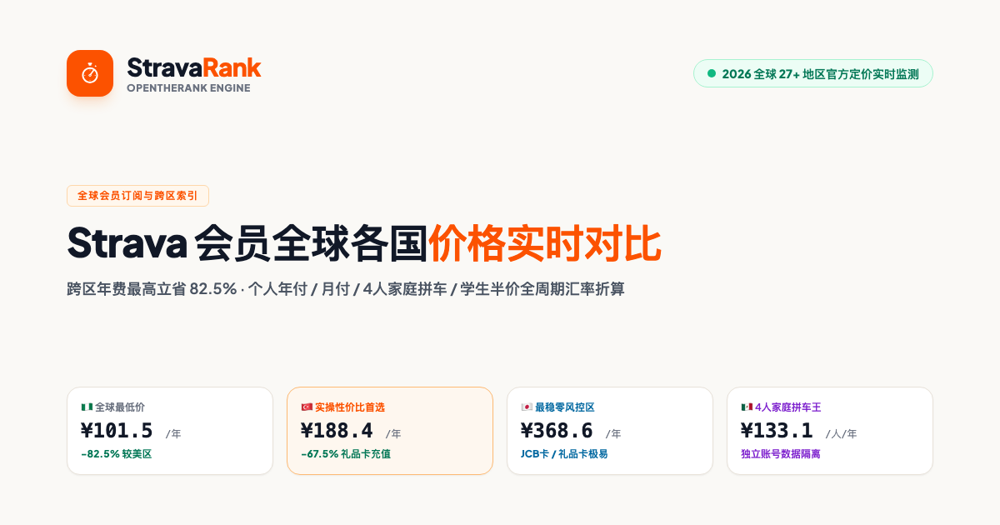

# ⏱️ StravaRank

**实时追踪全球 27+ 地区 Strava 官方订阅定价、每日外汇自动折算与跨区索引**

👉 **[在线访问：https://dday55.github.io/StravaRank/](https://dday55.github.io/StravaRank/)**

---

### ✨ 核心特性

- **多币种实时折算**：支持 CNY、USD、EUR、GBP、JPY 等币种一键切换，外汇牌价每日定时自动同步。
- **全周期套餐对比**：涵盖个人年付、月付、4 人家庭拼车人均及学生优惠方案。
- **实操门槛研判**：标记各地区发卡行 BIN 限制、外区礼品卡与国内信用卡实测支持情况。
- **4 人车队均摊测算**：动态滑块计算各区合租人均开销与每年集体节省金额。

---

### 🔄 数据更新机制

- **每日外汇汇率**：通过 GitHub Actions 每日北京时间早 08:00 自动拉取国际金融牌价并重排榜单；
- **官方标价巡检**：每周自动巡检 Apple App Store 全球 27 区内购公开定价变动。

---

### 📄 开源协议

本项目基于 [MIT License](LICENSE) 发布。
